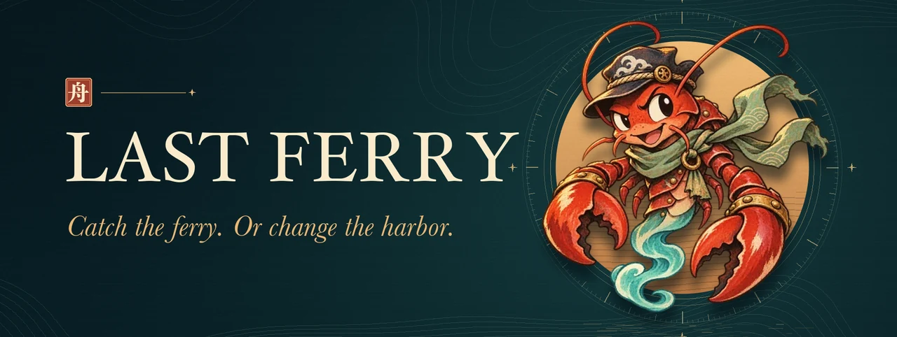

# Last Ferry

[](last-ferry-night-market-trailer.mp4)

**[Watch the trailer: Three Wishes at Night Market](last-ferry-night-market-trailer.mp4)** · 45 seconds

The bridge is too high to cross. Ask Wick to lower it. When it settles onto the dock, walk across.

**Last Ferry is a 3D adventure you can change while you play.** Type a wish into Wick’s parchment. The OpenClaw session that launched the game reads what you’re looking at and edits the running world. No reload, no trip to a level editor.

[Play with Wick](#play-with-wick) · [Try the trailer wishes](#try-the-three-wishes) · [Chain your wishes](#chain-your-wishes) · [Play without a model](#play-without-a-model) · [Inside the repo](#inside-the-repo)

## Play with Wick

You’ll need Node.js 22.12 or newer, npm, a WebGL 2 browser, and [OpenClaw](https://docs.openclaw.ai/start/getting-started) running on the same computer as the game. Use a session that can run shell commands and receive background command completions.

1. **Get the game.** From your terminal (if you already have the checkout, just run `npm ci` inside it):

   ```sh
   git clone https://github.com/bhensley5/last-ferry.git
   cd last-ferry
   npm ci
   ```

2. **Open this folder in OpenClaw.** For the hackathon setup, choose **Kimi K3.1 Pro on Cerebras** and **High** reasoning if available to your account. [Cerebras setup in OpenClaw](https://docs.openclaw.ai/providers/cerebras). Your provider credentials stay in OpenClaw; there is no game API key. Ask:

   > Start Last Ferry in Night Market.

3. **Open the exact link the session gives you.** The part after `#` connects Wick to this chat. Point at something in the game, press **Enter**, type a wish, and press **Enter** again to send. You can keep playing while Wick waits for the answer.

**Try this first:** *“Bring a midnight storm. Light the lanterns.”* Stand still for a moment: the sky, water, and lamps all change in the same view.

## Try the three wishes

In the trailer, Kimi on Cerebras launches the game and grants the midnight storm. The octopus toss and bridge crossing are gameplay demonstrations recorded on the demo dock.

To try all three yourself, start a **fresh Night Market** and tell Wick: **“Set up the demo dock.”** This brings the diver and a raised bridge to a quiet stretch of water. Normal play doesn’t change unless you ask for this setup.

| Say this to Wick | What to look for |
| --- | --- |
| “Turn him into an octopus. Throw him into the water.” | Point at the diver before opening the parchment. Watch him change on the dock, then follow the arc to the splash. |
| “Lower the bridge so I can cross.” | The bridge settles level with the two docks. Walk across to the lantern gate; no jump needed. |
| “Bring a midnight storm. Light the lanterns.” | Turn back toward the market. The same harbor is now dark, wet, and lit. |

## Chain your wishes

You can tell Wick what to change **and what should happen next**. Ask for the whole thing in one wish, or build on an earlier one: give yourself a grappling hook now, then decide what it can grab once you meet the boss.

1. **Wire up a ferry light · Night Market**

   *“Put a pressure plate on the ferry. Light a lantern on the dock while anyone is standing on the plate.”*

   Step on with a crew member, then step off alone. The lantern stays lit until the last one leaves, even as the ferry moves.

2. **Give the boss fight a new move · Ember Pass**

   *“Give me a grappling hook. Let it catch the Ember Hart’s antlers only while he’s catching his breath. Drop the rope when he’s ready to attack again.”*

   Aim between attacks. The rope follows the antler you actually hit; the Hart’s recovery, not a timer on your hook, decides when to let go.

3. **Write a different ending · Ember Pass**

   *“I don’t want to kill the Hart. Put three burning braziers in his arena and give me a water cannon. If I put out all three, have him stand down and let me finish the chapter.”*

   Hitting the same brazier three times won’t do it. Put out the last fire and the fight ends with the Hart still alive.

## Play without a model

After `npm ci`, run:

```sh
npm run dev
```

Open **[localhost:5179](http://127.0.0.1:5179)**. Both chapters are playable. Try *“Make it sunrise”* for a built-in edit that needs no account. This plain link is **not** connected to a chat. In development, other free-form wishes can use a configured local OpenClaw CLI; a static build has only the built-in edits. Stop the dev server with **Ctrl-C**.

### Where to go

- **Night Market:** Light five harbor signals and catch the moving ferry. Take the pottery roofs or follow the garden route to the lighthouse.
- **Ember Pass:** Follow gold signposts through the tea terraces to the Ember Hart, or detour through the Koi Steps and Moon Observatory. Lower Moon Bridge with a wish, or take the gorge road without one.

| Controls | Action |
| --- | --- |
| WASD or arrows · Shift | Move · run |
| Drag or Q/E · scroll | Orbit · zoom |
| Space · Space again in midair | Jump · vault |
| F or click · G | Attack · use a bell or shrine |
| Enter · R | Write a wish · return to your checkpoint |
| X · 1–4 | Dash or use custom abilities, when granted |

A fresh link starts a new run. To keep this one, ask the opening session to **bookmark it** before closing the game. Reopen the same link on the same computer; bookmarks live in local temporary storage, not a cloud account.

<details>
<summary>Wick isn’t answering?</summary>

- **The game works, but only simple edits do:** reopen the full link from the opening session. The plain localhost URL is standalone.
- **The parchment says “Wish delivered”:** the request is already queued. Keep the game tab visible and ask the opening session to check the pending wish and its listener; no need to send it twice.
- **There’s a HUD but no 3D scene:** use a WebGL 2 browser with graphics acceleration enabled.

</details>

## How a wish works

**Parchment → opening session → live edit → rendered game.** When you open the parchment, the game remembers what was under your pointer. OpenClaw reads that target and the current state of your tab, then sends a small patch. The browser checks it, applies it, and returns a receipt after drawing a frame.

The model is in the loop **when you ask**, not on every frame. It can give a bell a price or bind a grappling hook to a key. After that, the game handles each payment, hit, or swing locally. Faster inference shortens the pause between asking and acting; it doesn’t change the frame rate.

## Inside the repo

| Path | Why it’s here |
| --- | --- |
| [levels/](levels/) | The playable chapters and a small compatibility map. Add a chapter here to put it in the selector and launch CLI. |
| [src/](src/) · [index.html](index.html) | The Three.js game, controls, combat, world edits, Wick’s parchment, and the art they use. Textures ship locally. |
| [skills/last-ferry/](skills/last-ferry/SKILL.md) · [AGENTS.md](AGENTS.md) | The game master’s instructions: how to launch, identify a target, combine edits, and verify an outcome. |
| [tools/](tools/) · [vite.config.js](vite.config.js) | The local command-line remote, wish inbox, and development bridge connecting one session to its game. |
| [test/](test/) | Regression checks for routes, combat, physics, and wish rules. Run them with `npm test`. |
| [package.json](package.json) · [package-lock.json](package-lock.json) | Commands and pinned dependencies. `npm run build` makes the static game in `dist/`; `npm run preview` serves it. |

**Art & tools.** Built with [Three.js](https://threejs.org/), [Vite](https://vite.dev/), and [QuickJS](https://github.com/justjake/quickjs-emscripten) for player-authored rules. The README artwork features the same Wick you meet in the game. Market timber, skies, and ground use CC0 photography from Poly Haven: [Wood Planks Dirt](https://polyhaven.com/a/wood_planks_dirt), [Lago Disola](https://polyhaven.com/a/lago_disola), Qwantani [dusk](https://polyhaven.com/a/qwantani_dusk_2), [morning](https://polyhaven.com/a/qwantani_morning), [dawn](https://polyhaven.com/a/qwantani_dawn), [moonrise](https://polyhaven.com/a/qwantani_moonrise), [Grass Ground](https://polyhaven.com/a/grass_ground), and [Stony Dirt Path](https://polyhaven.com/a/stony_dirt_path).
